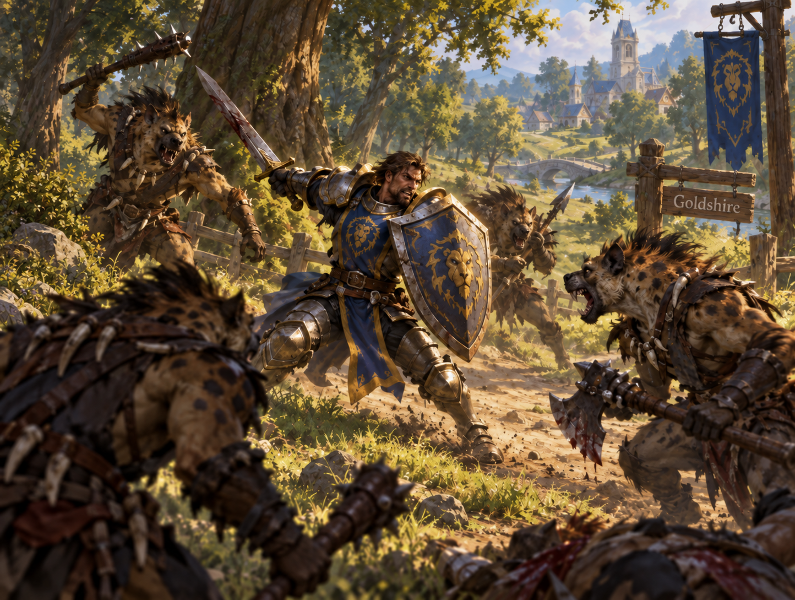

<p align="center">
  
</p>

# Omarchy Human Warrior Theme

An Omarchy theme for sunlit forest roads. Alliance blue and burnished gold sit on warm parchment, with moss green and rust at the edges.

This is a light theme (`mode = "light"`).

## Install

```sh
omarchy-theme-install https://github.com/csfh/omarchy-human-warrior-theme
```

You can also install it from the Omarchy menu with `Super + Alt + Space`, then `Install > Style > Theme`, using this repository URL:

```text
https://github.com/csfh/omarchy-human-warrior-theme
```

## Palette

| Role | Hex |
| --- | --- |
| Background | `#f2eee0` |
| Foreground | `#1d1b14` |
| Accent | `#2653a6` |
| Red | `#a03a28` |
| Green | `#52762a` |
| Yellow | `#876717` |
| Blue | `#2653a6` |
| Magenta | `#7e4a62` |
| Cyan | `#2f726a` |

## Included

A `colors.toml` palette, an icon theme (`Yaru-blue`) and a wallpaper. Omarchy builds the terminal, editor, launcher, notification, bar, lock screen, browser and TUI themes from this palette, so `colors.toml` is the single source of truth.

## Backgrounds

The wallpaper:

- [`human-warrior`](backgrounds/human-warrior.png)

## License

MIT. See [LICENSE](LICENSE). Copyright (c) 2026 Christoffer Hallas.

If you send a pull request or other contribution, you agree to the [CLA](CLA.md).
